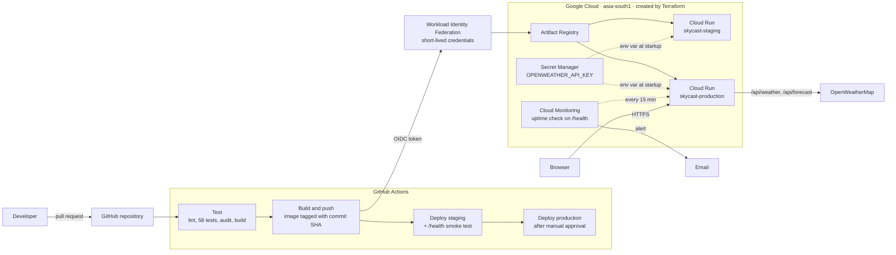

# SkyCast: Serverless CI/CD Pipeline on GCP with Terraform

[](https://github.com/aquaaditi/terraform-cloudrun-cicd/actions/workflows/ci-cd.yml)

A weather app (React + Node.js/Express) deployed to **Google Cloud Run** by a **GitHub Actions**
pipeline. All cloud infrastructure is defined in **Terraform**, GitHub authenticates to Google with
**Workload Identity Federation** (no key files), and production releases need a manual approval.

**Live:** [Production](https://skycast-production-4kivggshpa-el.a.run.app) ·
[Staging](https://skycast-staging-4kivggshpa-el.a.run.app)

<!-- Screenshot: docs/screenshots/app-desktop.png -->

## Architecture



## Highlights

**DevOps**
- **Infrastructure as Code:** 27 GCP resources in Terraform with remote state in a versioned GCS bucket.
- **Keyless CI/CD:** GitHub Actions gets short-lived Google credentials through Workload Identity
  Federation, restricted to this repository. No service account keys exist.
- **Build once, deploy many:** one image per commit, tagged with the git SHA, promoted from staging
  to production after a smoke test and a manual approval.
- **Least privilege:** separate runtime and deployer service accounts, with permissions granted on
  specific resources (one repository, two services, one secret), never project-wide.
- **Secrets stay secret:** the API key lives in Secret Manager, is injected at runtime, and never
  appears in the image, the browser, logs or Terraform state.
- **Observability and recovery:** uptime check with email alerting, and a documented
  [rollback runbook](docs/ROLLBACK.md) using Cloud Run revisions.
- **Small, hardened container:** multi-stage build on `node:24-alpine`, non-root user, read-only app
  files, graceful SIGTERM shutdown. 250 MB, against 1.93 GB for a naive single-stage build.

**Application**
- Express backend proxies OpenWeatherMap so the API key never reaches the browser.
- 10-minute in-memory cache: repeat lookups drop from about 440 ms to about 2 ms (`X-Cache` header).
- 5-day forecast summarised on the server in the city's timezone (about 32 times smaller payload).
- Animated weather scenes, live local clock, sunrise-to-sunset arc, °C/°F, responsive and accessible.

## Tech stack

| Area | Tools |
|---|---|
| Frontend | React 19, Vite, Lucide icons, CSS animations |
| Backend | Node.js 24 LTS, Express 5 |
| Testing and quality | Jest, supertest, ESLint, npm audit, actionlint |
| Container | Docker multi-stage build, `node:24-alpine` |
| Infrastructure | Terraform, Google provider 8.x, GCS remote state |
| Google Cloud | Cloud Run, Artifact Registry, Secret Manager, IAM, Workload Identity Federation, Cloud Monitoring |
| CI/CD | GitHub Actions, GitHub Environments |

## Repository layout

```
.github/workflows/ci-cd.yml   Pipeline: test -> build -> staging -> production
server/                       Express API (health, weather, forecast, cache)
src/                          React frontend
tests/                        Jest + supertest tests (58)
terraform/                    All GCP infrastructure
scripts/                      One-time GCP bootstrap and infrastructure apply
docs/                         Rollback runbook, study notes, interview prep
Dockerfile                    Multi-stage production image
```

## How the pipeline works

| Trigger | Jobs |
|---|---|
| Pull request to `main` | **Test:** `npm ci`, ESLint, 58 Jest tests, production dependency audit, Vite build |
| Push to `main` | Test → **Build** image `…/skycast:<commit-sha>` and push to Artifact Registry → **Deploy staging** and smoke-test `/health` → **Deploy production** after approval |

- Authentication uses `google-github-actions/auth` with Workload Identity Federation. The provider
  only accepts tokens from `aquaaditi/terraform-cloudrun-cicd`.
- The `production` GitHub Environment requires a reviewer, only allows the `main` branch, and has no
  admin bypass.
- Documentation-only changes skip the build and deploy.

<!-- Screenshot: docs/screenshots/pipeline-run.png (Actions run with the approval step) -->

## Run it locally

Requirements: Node.js 24, an [OpenWeatherMap API key](https://home.openweathermap.org/api_keys).

```bash
npm ci
cp .env.example .env          # then put your key in .env
npm run build
npm run dev:server            # http://localhost:8080
npm test                      # 58 tests, no API key or internet needed
```

Frontend development with hot reload: run `npm run dev:server` and `npm run dev` together, then
open http://localhost:5173 (Vite proxies `/api` to Express).

With Docker:

```bash
docker build -t skycast:local .
docker run -d --name skycast -p 8080:8080 --env-file .env skycast:local
```

## Deploy your own copy

1. Create a GCP billing account, then run the idempotent bootstrap (project, billing link, budget
   alert, state bucket, `terraform.tfvars`):
   ```powershell
   powershell -ExecutionPolicy Bypass -File .\scripts\bootstrap-gcp.ps1 -ProjectId <project-id> -AlertEmail <you@example.com>
   ```
2. Initialise Terraform and create the infrastructure (the script also stores the API key in
   Secret Manager straight from `.env`):
   ```powershell
   cd terraform
   terraform init -backend-config="bucket=<project-id>-tfstate"
   cd ..
   powershell -ExecutionPolicy Bypass -File .\scripts\apply-infra.ps1
   ```
3. In GitHub, add repository variables `GCP_PROJECT_ID`, `GCP_REGION`, `GCP_WIF_PROVIDER` and
   `GCP_DEPLOYER_SA` (from `terraform output`), and create the `staging` and `production`
   environments.
4. Merge a pull request into `main`.

## Rollback

Cloud Run keeps every revision, so a bad release can be undone in seconds:

```powershell
gcloud run revisions list --service skycast-production --region asia-south1
gcloud run services update-traffic skycast-production --region asia-south1 --to-revisions <GOOD_REVISION>=100
```

The full runbook, including reverting through the pipeline and redeploying an image by SHA, is in
[docs/ROLLBACK.md](docs/ROLLBACK.md).

## Monitoring

A Cloud Monitoring uptime check calls production `/health` every 15 minutes from the USA, Europe and
Asia-Pacific. If 2 or more regions fail, an email alert is sent with rollback guidance.

<!-- Screenshot: docs/screenshots/uptime-check.png -->

## Cost notes

Designed to stay within or very close to Google Cloud's free tier:

- Cloud Run scales to zero (`min_instance_count = 0`), bills CPU only during requests, and is capped
  at 1 instance for staging and 2 for production.
- Artifact Registry cleanup keeps the 10 newest images and deletes untagged ones after 7 days.
- The uptime check runs every 15 minutes from the minimum of 3 regions.
- The 10-minute cache reduces calls to OpenWeatherMap.
- A budget alert emails at 50%, 90% and 100% of ₹500.

## Clean up

```powershell
cd terraform
$env:GOOGLE_OAUTH_ACCESS_TOKEN = gcloud auth print-access-token
terraform destroy
```

Then delete the state bucket, or delete the whole project:
`gcloud projects delete <project-id>`.

## Documentation

- [ROADMAP.md](ROADMAP.md): plan and progress
- [DEVLOG.md](DEVLOG.md): daily log of what was built, learned and fixed
- [docs/ROLLBACK.md](docs/ROLLBACK.md): incident rollback runbook
- [docs/NOTES.md](docs/NOTES.md): study notes
- [docs/INTERVIEW_PREP.md](docs/INTERVIEW_PREP.md): interview questions and answers
