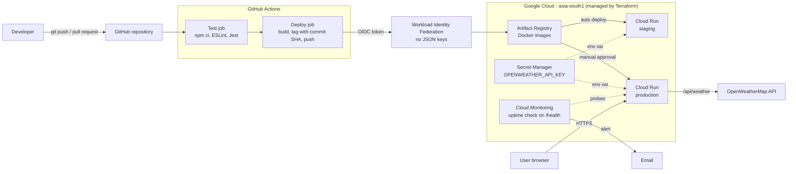

# Roadmap: Serverless CI/CD Pipeline on GCP with Terraform

A weather app (React + Node.js/Express) deployed to **Google Cloud Run** through a
**GitHub Actions** pipeline, with all cloud infrastructure defined in **Terraform**.

## Target architecture

**Key design decisions**
- The API key lives only on the server (Secret Manager → Cloud Run env var) and never reaches the browser.
- GitHub Actions authenticates to GCP with short-lived OIDC tokens (Workload Identity Federation), not stored key files.
- Every image is tagged with the Git commit SHA, so any deployment can be traced back to its code.
- Cloud Run scales to zero (`min_instances = 0`) to stay within the free tier.

## Phase plan

Each day is roughly 2–3 hours and ends with small, Conventional Commits pushed to GitHub.

| Day | Phase | Deliverables | Status |
|-----|-------|--------------|--------|
| 1 | 0. Setup | Inspect app, install tools, git + `.gitignore`, first push | ✅ Done |
| 2 | 1. Backend | Express server: `/health`, `/api/weather` proxy, serve React build, `.env.example` | ✅ Done |
| 3 | 1. Tests | Jest + supertest tests with mocked API, ESLint for Node | ✅ Done |
| 3+ | Extra | `/api/forecast` route, UI redesign (themes, details, 5-day forecast) | ✅ Done |
| 4 | Extra | Server-side caching (10-minute TTL, `X-Cache` header) | ✅ Done |
| 4 | 2. Docker | Multi-stage Dockerfile (node:24-alpine), non-root user, `.dockerignore`, graceful shutdown | ✅ Done |
| 5 | 3. Terraform I | Budget alert, remote state, provider, variables, APIs, Artifact Registry | ⬜ |
| 6 | 3. Terraform II | Least-privilege service accounts, Secret Manager, Cloud Run | ⬜ |
| 7 | 3. Terraform III | Workload Identity Federation pool + provider for GitHub | ⬜ |
| 8 | 4. CI | Feature branch, test workflow, first pull request | ⬜ |
| 9 | 4. CD | Deploy job: WIF auth, build, push, deploy to Cloud Run | ⬜ |
| 10 | 5. Environments | Staging auto-deploy, production behind GitHub Environment approval | ⬜ |
| 11 | 5. Monitoring | Uptime check + email alert policy, rollback runbook | ⬜ |
| 12 | 6. Docs | README with diagram, pipeline walkthrough, costs, screenshots | ⬜ |
| 13–14 | Buffer | Fixes, hardening, interview revision | ⬜ |

## Progress log

Detailed daily notes (what was built, what was learned, problems and fixes) are in [DEVLOG.md](DEVLOG.md).
